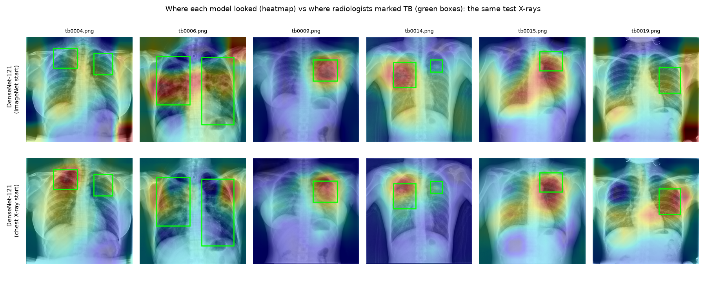

# LungLens: TB screening from chest X-rays

[](https://github.com/zyna-b/lunglens/actions/workflows/test.yml)
 

**Upload a chest X-ray → healthy / sick but not TB / TB, plus a heatmap of where the model looked. Runs in the browser; the X-ray never leaves your device.**

[Live demo](https://lunglens-tb.vercel.app) · [Report (PDF)](https://lunglens-tb.vercel.app/report.pdf) · [Slides](https://lunglens-tb.vercel.app/slides.pdf) · Video (coming soon) · LinkedIn post (coming soon) · [Dataset (Kaggle)](https://www.kaggle.com/datasets/vbookshelf/tbx11k-simplified) · [Model card](model_card.json)

Deep Learning semester project, BSCS-7A, Superior University, Lahore. Instructor: Dr. Munir Ahmad. Author: Zainab Hamid.



## Results (1,800 held-out test X-rays)

| Model | Params | Test accuracy | Balanced acc. | TB AUC (95% CI) | Sensitivity | Specificity | Heatmap hits TB box | CPU ms |
|---|---|---|---|---|---|---|---|---|
| CNN from scratch | 2.35M | 96.9% | 97.0% | 0.9952 (0.9921–0.9979) | 98.0% | 94.6% | 34% | 246 |
| DenseNet-121 (ImageNet start) **(deployed)** | 6.96M | 99.2% | 98.4% | 0.9996 (0.9991–0.9999) | 100.0% | 95.9% | 36% | 313 |
| DenseNet-121 (chest X-ray start) | 6.95M | 98.3% | 97.0% | 0.9965 (0.9936–0.9984) | 98.0% | 95.8% | 57% | 294 |

- Deployed: **DenseNet-121 (ImageNet start)**, chosen on validation balanced accuracy.
- Screening rule: refer for a lab test if `probs[tb] >= 0.0070` (95% specificity on validation non-TB X-rays). At that threshold: **100.0% sensitivity, 95.9% specificity** (WHO triage minimum: 90% / 70%).
- Pointing game: the TB heatmap's hottest point lies inside a radiologist's box in **36.0%** of TB test X-rays (random point: 9.8%).
- 95% bootstrap CIs: accuracy 98.8%–99.6%, TB AUC 0.9991–0.9999.

## Test it in 3 commands

```bash
git clone https://github.com/zyna-b/lunglens && cd lunglens
pip install -r requirements.txt          # or just: pip install numpy pillow onnxruntime
python evaluate.py                       # 12 bundled, labelled test X-rays in samples/
```

```bash
python predict.py samples/tb_1.png --heatmaps out/    # JSON + heatmap overlay
python evaluate.py --data /path/to/tbx11k-simplified  # the full 1,800-image test split
```

`predict.py` prints, per X-ray (real output for `samples/tb_1.png`):

```json
{
 "prediction": "tb",
 "probabilities": {
  "healthy": 0.0001,
  "sick_but_not_tb": 0.0401,
  "tb": 0.9598
 },
 "screening": {
  "tb_probability": 0.9598,
  "threshold": 0.007,
  "result": "refer for a TB lab test (sputum / GeneXpert)"
 }
}
```

## Weights

| File | What | Load with |
|---|---|---|
| `weights/lunglens.onnx` | deployed model, outputs `probs` [1,3] and `cam` [1,3,12,12] | `onnxruntime.InferenceSession(...)` |
| `weights/lunglens_torchscript.pt` | same model, TorchScript | `torch.jit.load(...)` |
| `weights/<model>.pt` | PyTorch checkpoints of all three models | `lunglens.models.load_checkpoint(...)` |

Input: one grayscale X-ray, resized to 384×384, float32 in [0, 1], shape `[1, 1, 384, 384]`; normalisation is inside the model. Classes: `['healthy', 'sick_but_not_tb', 'tb']`. SHA-256 of every file: [model_card.json](model_card.json).

## Data

[TBX11K](https://www.kaggle.com/datasets/vbookshelf/tbx11k-simplified) (Liu et al., CVPR 2020, CC BY 4.0): 8,399 labelled 512×512 X-rays, TB regions boxed by radiologists. Test = TBX11K's labelled validation set (800 / 800 / 200); its training set is split 90/10 into train / validation (stratified, seed 42). Exact files: [`data/splits.csv`](data/splits.csv).

## Method

Three models with identical data, augmentation (GPU; rotation, shift, zoom, exposure, noise, blur; **no flips**), class-weighted cross-entropy, AdamW + cosine schedule:

1. `cnn_scratch`: 5-block CNN from random weights (2.4M params)
2. `densenet121_imagenet`: DenseNet-121 from ImageNet weights
3. `densenet121_cxr`: the same DenseNet-121 from TorchXRayVision chest-X-ray weights

Every model ends in global average pooling + one linear layer, so the class activation map comes out of the same forward pass ([`lunglens/models.py`](lunglens/models.py)); the website draws it without gradients.

## Reproduce

Training ran on one NVIDIA L4 in Google Colab: [`notebooks/LungLens_train.ipynb`](notebooks/LungLens_train.ipynb) (all outputs kept).

```bash
python train.py --data /path/to/tbx11k-simplified --model densenet121_cxr --out outputs   # ~17 min on an L4
python rescore.py --data /path/to/tbx11k-simplified --out outputs
python report.py --runs outputs --data /path/to/tbx11k-simplified                          # weights/, figures, model card
```

## Repository

```
predict.py  evaluate.py          inference (numpy + pillow + onnxruntime only)
train.py  rescore.py  report.py  training, re-scoring, export + figures
lunglens/                        models, data, augmentation, metrics
data/splits.csv                  exact train / val / test files
weights/                         ONNX, TorchScript, PyTorch checkpoints
samples/                         12 labelled test X-rays (CC BY 4.0, TBX11K)
results/                         metrics, per-image predictions, figures
docs/                            report (PDF + HTML), slides (PPTX, PDF), voiceover script
site/  scripts/build_site.py     the website (deployed on Vercel from web/)
notebooks/                       executed Colab training notebook
```

## Limits

Trained and tested on TBX11K (Chinese hospitals); not validated on Pakistani X-rays. Adults only. A research and teaching demo, **not a medical device**: a positive screen needs a lab test, a negative one does not rule TB out.

## Credits

TBX11K: Liu, Wu, Ban, Wang, Cheng, *Rethinking Computer-aided Tuberculosis Diagnosis*, CVPR 2020 (CC BY 4.0). Chest X-ray weights: TorchXRayVision (Cohen et al., MIDL 2022). Code: MIT licence.
